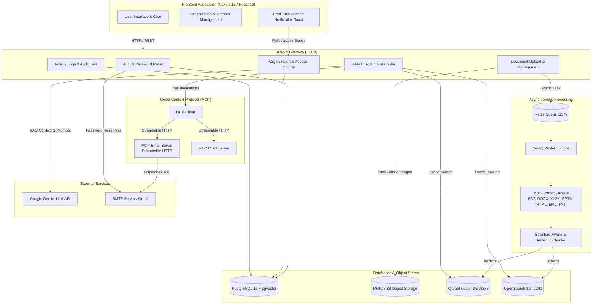

# RAG Document Intelligence Platform (DocGPT)

[](https://fastapi.tiangolo.com)
[](https://nextjs.org)
[](https://react.dev)
[](https://www.docker.com)
[](https://qdrant.tech)
[](https://opensearch.org)
[](https://min.io)
[](https://modelcontextprotocol.io)
[](https://ai.google.dev)

An enterprise-grade, multi-tenant **Retrieval-Augmented Generation (RAG) & Document Intelligence Platform**. The platform processes documents across virtually any file format, powers intelligent conversational exploration with Google Gemini, features Model Context Protocol (**MCP**) integration for automated email dispatch over SMTP, and delivers comprehensive multi-tenant organization management with real-time access controls and audit logging.

---

## Table of Contents

- [Key Features](#-key-features)
- [System Architecture](#-system-architecture)
- [Technology Stack](#-technology-stack)
- [Multi-Tenant Organization & Access Control](#-multi-tenant-organization--access-control)
- [Model Context Protocol (MCP) & Email Integration](#-model-context-protocol-mcp--email-integration)
- [Supported Document Formats](#-supported-document-formats)
- [Project Directory Structure](#-project-directory-structure)
- [Getting Started](#-getting-started)
  - [Prerequisites](#prerequisites)
  - [Environment Configuration](#environment-configuration)
  - [Running with Docker Compose](#running-with-docker-compose-recommended)
  - [Running Locally for Development](#running-locally-for-development)
- [API Endpoints Overview](#-api-endpoints-overview)
- [Security & Access Controls](#-security--access-controls)
- [Contributing & License](#-contributing--license)

---

## 🚀 Key Features

### 📄 Universal Multi-Format Document Processing
- **Reads virtually any file type**: Native parsing for **PDF, DOCX, DOC, XLSX, XLS, PPTX, PPT, CSV, HTML, EML (emails), TXT, Markdown, JSON, and server logs**.
- **Smart MIME & Content Inspection**: Multi-stage detection inspects file extensions, MIME headers, and raw file magic bytes with automatic fallback to UTF-8 text decoding.
- **Asynchronous Ingestion Pipeline**: Large documents are ingested asynchronously using Celery background workers with Redis queuing and dead-letter retry safety.
- **Structure-Aware Chunking**: Semantic and layout-aware chunking strategies preserve section boundaries, headers, tables, and document hierarchy.

### 🤖 Intelligent Conversational RAG & Analysis
- **Google Gemini Integration**: Advanced reasoning over single documents or cross-organizational corpora using `gemini-2.5-flash` with dynamic model fallback.
- **Verifiable Citations**: Every answer provides precise source attribution, document references, and citation trails.
- **Data Visualization**: Automatic generation and rendering of charts (bar, line, pie) via Recharts directly within the conversation window.
- **Interactive 3D Knowledge Sphere**: Three.js-powered knowledge visualization displaying document relations and cluster maps.

### ✉️ MCP-Powered Email Dispatch & SMTP Service
- **Model Context Protocol (MCP) Architecture**: Dedicated MCP server microservice (`backend/mcp/email_server.py`) communicating over Streamable HTTP transport.
- **Chat-Driven Email Sending**: Simply ask the chat assistant to send an email (e.g., *"Email the summary of this financial report to team@company.com with the document attached"*). DocGPT extracts recipients, drafts the email, and triggers the MCP tool.
- **Document Attachments**: Automatically resolves and attaches the active document directly to the outgoing email.
- **Secure Password Reset**: Forgot-password workflow that generates single-use, 30-minute expiration tokens and delivers secure reset links to users via SMTP.

### 🏢 Multi-Tenant Organization Management
- **Single Email, Multiple Organizations**: Administrators can register and manage multiple distinct organizations using the same email address while maintaining unique usernames per account.
- **Seamless Organization Switching**: Admins can switch between their organizations in one click without re-authenticating or signing out.
- **Team Invitations**: Admins can invite registered members to their organization by email. Members receive invitations in-app and can accept or decline.
- **Admin Document Sharing**: When an admin grants access to a member, the admin's organization documents are immediately shared with that member for reading, searching, and chatting.
- **Instant Access Revocation**: Admins can revoke access or remove members at any time, instantly cutting off access to organization documents and search queries.
- **Real-Time Live Access Notifications**: If a member is logged in when an admin grants or revokes their access, the application triggers a real-time toast alert (*"Access granted by admin"* / *"Access revoked by admin"*) without requiring a page reload.
- **Audit Trails & Member Activity Logs**: Full visibility into team activities. Admins can view timestamps, usernames, and activity types (document uploads, queries, deletions) for individual documents or across the entire organization, with the ability to clear logs.

---

## 🏛 System Architecture



---

## 💻 Technology Stack

| Layer | Technologies |
|---|---|
| **Frontend** | Next.js 15 (App Router), React 19, Vanilla CSS (Glassmorphism design), Recharts, Three.js (@react-three/fiber), Mammoth, SheetJS (XLSX) |
| **Backend API** | Python 3.11, FastAPI, Pydantic v2, Uvicorn, SQLAlchemy, Alembic |
| **Asynchronous Engine** | Celery, Redis, Solo worker pool with dead-letter queue |
| **Databases** | PostgreSQL 16 with `pgvector`, Qdrant Vector Database, OpenSearch 2.9 (BM25 lexical search) |
| **Object Storage** | MinIO (AWS S3-compatible) for raw documents, page images, extracted tables, and avatars |
| **LLM & Embeddings** | Google Gemini (`gemini-2.5-flash`), `sentence-transformers` (`all-MiniLM-L6-v2`) |
| **Protocols & Integrations** | Model Context Protocol (**MCP**), Streamable HTTP, Python SMTP (`smtplib`, `email.message`) |
| **Document Parsers** | PyMuPDF (fitz), python-docx, openpyxl, python-pptx, lxml, csv, email/rfc822 |
| **DevOps & Containerization** | Docker, Docker Compose, Multi-stage builds |

---

## 🏢 Multi-Tenant Organization & Access Control

The platform provides a flexible, secure multi-tenant architecture designed for corporate teams:

1. **Organization Creation with Shared Email**:
   - An administrator can register multiple organizations using the same email address.
   - Each registration creates a distinct tenant while linking the administrator's identity.
2. **Organization Switching**:
   - Admins can switch between their registered organizations instantly via the settings modal.
   - Sessions are updated immediately with an organization-scoped JWT token.
3. **Member Lifecycle**:
   - **Invite**: Admin sends an invitation by email.
   - **Accept / Decline**: Invitee receives the request in their dashboard and can accept or decline.
   - **Grant Access**: When an admin grants access, the member's status changes to `active` and all organization documents uploaded by the admin become available to them.
   - **Revoke Access**: Admin can revoke access with a single click, immediately restricting document and chat access.
   - **Remove Member**: Admin can permanently remove members from the organization.
4. **Live In-App Access Feedback**:
   - The frontend continuously monitors access status via `OrganizationAccessNotification`.
   - When an admin grants or revokes access, a banner notification pops up in real time for logged-in members.
5. **Activity Logs & Audit Trail**:
   - Every key action is audited (`ActivityLogModel`):
     - `DOCUMENT_UPLOADED`
     - `DOCUMENT_DELETED`
     - `DOCUMENT_QUERIED`
     - `MEMBER_INVITED`
     - `ACCESS_GRANTED` / `ACCESS_REVOKED`
   - Admins can filter logs by document or view full organization logs, and clear logs when needed.

---

## ✉️ Model Context Protocol (MCP) & Email Integration

The platform includes an internal **Model Context Protocol (MCP)** microservice implementing the open [Model Context Protocol specification](https://modelcontextprotocol.io).

### How Chat Emailing Works:
1. **User Prompt**: In the chat window, the user types:
   > *"Send an email to john@example.com summarizing this contract and attach the file."*
2. **Intent Classification & Extraction**:
   - `EmailActionExtractor` inspects conversation history and active document context using Gemini with structured JSON output.
   - Accurately resolves recipient email addresses, subject line, body text, and whether the active document should be attached.
3. **MCP Tool Call**:
   - Backend calls the `MCPClient` which connects to `http://mcp-email:8000/mcp` using Streamable HTTP.
   - The MCP tool `send_email(to, subject, body, attachments)` is invoked with the base64-encoded file payload.
4. **SMTP Dispatch**:
   - The MCP server transmits the email via standard SMTP (e.g., Gmail SMTP or company mail servers).
   - The user receives immediate confirmation in the chat interface.

### Password Reset Flow:
- When a user requests a password reset on `/reset-password`, the system generates a secure, 30-minute token and sends an email via SMTP containing a single-use reset URL.

---

## 📂 Supported Document Formats

The ingestion engine automatically identifies and parses virtually all standard document formats:

| Format | Extensions | Parser Engine | Extracted Information |
|---|---|---|---|
| **PDF** | `.pdf` | PyMuPDF (`fitz`) | Text, bounding boxes, page images, metadata |
| **Word** | `.docx`, `.doc` | `python-docx` | Headings, paragraphs, bullet points, tables |
| **Excel** | `.xlsx`, `.xls` | `openpyxl` | Worksheets, rows, columnar records |
| **PowerPoint** | `.pptx`, `.ppt` | `python-pptx` | Slide titles, slide notes, shape text |
| **Delimited Data** | `.csv` | Python `csv` | Structured tables and comma-separated rows |
| **Web & Markup** | `.html`, `.htm`, `.xhtml` | `lxml` / HTML parser | DOM text, article body, headings |
| **Emails** | `.eml` | Python RFC 822 `EmlParser` | Sender, recipients, subject, date, email body |
| **Plain Text & Code**| `.txt`, `.md`, `.json`, `.log` | `TextDocumentParser` | Raw text, JSON structures, logs, Markdown |
| **Binary Fallback** | Any unrecognized file | Magic byte inspector | Header inspection with UTF-8 fallback decoding |

---

## 📁 Project Directory Structure

```text
rag-document-intelligence/
├── backend/                            # FastAPI Backend & Core Services
│   ├── api/
│   │   ├── controllers/                # REST API Endpoints
│   │   │   ├── access_requests.py      # Member access requests & approvals
│   │   │   ├── account_management.py   # Multi-organization switching & management
│   │   │   ├── activity.py             # Audit trail & activity logs
│   │   │   ├── auth.py                 # JWT authentication & password reset
│   │   │   ├── documents.py            # Upload, download, deletion & permissions
│   │   │   ├── organization_members.py # Member invitations, grant/revoke access
│   │   │   ├── profile.py              # Profile picture & account settings
│   │   │   └── query.py                # RAG query, chat assistant & MCP email
│   │   └── schemas/                    # Pydantic request/response schemas
│   ├── auth/                           # Security, password hashing & SMTP email service
│   ├── chunking/                       # Fixed, semantic & structure-aware chunkers
│   ├── database/                       # SQLAlchemy models, sessions & CRUD
│   ├── generation/                     # Gemini LLM generation, prompts & email actions
│   ├── indexing/                       # Qdrant & OpenSearch indexing logic
│   ├── ingestion/                      # Multi-format document parser factory
│   │   └── parsers/                    # PDF, DOCX, XLSX, PPTX, CSV, HTML, EML, TXT
│   ├── mcp/                            # Model Context Protocol Microservices
│   │   ├── email_server.py             # MCP Email Server (Streamable HTTP)
│   │   ├── chart_server.py             # MCP Chart Server
│   │   └── client.py                   # MCP Client for tool execution
│   ├── storage/                        # MinIO / AWS S3 client wrapper
│   └── workers/                        # Celery async worker & task definitions
│
├── frontend/                           # Next.js 15 Frontend
│   ├── app/
│   │   ├── api/                        # Next.js proxy route handlers
│   │   ├── reset-password/             # Forgot password reset page
│   │   ├── settings/                   # Organization & account settings page
│   │   ├── globals.css                 # Custom responsive glassmorphism CSS
│   │   └── page.jsx                    # Main dashboard & interactive chat UI
│   └── components/
│       ├── ChartRenderer.jsx           # Recharts visualization component
│       ├── KnowledgeSphere.jsx         # Three.js 3D knowledge graph
│       ├── LoginPage.jsx               # Auth modals (Login, Signup, Forgot PW)
│       └── OrganizationAccessNotification.jsx # Live in-app access toast
│
├── infrastructure/                     # Infrastructure configurations
│   └── postgres/                       # PostgreSQL pgvector Dockerfile & init SQL
├── docker-compose.yml                  # Complete multi-container orchestration
├── .env.example                        # Template environment configuration
└── README.md                           # Project documentation
```

---

## 🛠 Getting Started

### Prerequisites

- [Docker](https://docs.docker.com/get-docker/) & [Docker Compose](https://docs.docker.com/compose/) (v2.20+)
- *(Optional for host-based development)*: Python 3.11+, Node.js 18+

---

### Environment Configuration

1. Clone the repository:
   ```bash
   git clone https://github.com/your-username/rag-document-intelligence.git
   cd rag-document-intelligence
   ```

2. Copy the example configuration file:
   ```bash
   cp .env.example .env
   ```

3. Open `.env` and fill in your credentials:
   - **Google Gemini API**: Set `GEMINI_API_KEY` with your key from [Google AI Studio](https://aistudio.google.com/).
   - **SMTP Credentials**: Set `SMTP_USERNAME` and `SMTP_PASSWORD` (use a [Google App Password](https://myaccount.google.com/apppasswords) if using Gmail).
   - **JWT Secret**: Set `JWT_SECRET` to a secure 32+ character string.

---

### Running with Docker Compose (Recommended)

Start all services (Postgres, Redis, MinIO, Qdrant, OpenSearch, FastAPI, MCP servers, Celery worker, and Next.js frontend):

```bash
docker compose up --build
```

To run in the background (detached mode):
```bash
docker compose up -d
```

#### Accessing Application Services:

| Service | URL | Default Credentials |
|---|---|---|
| **Web Application** | [http://localhost:3000](http://localhost:3000) | - |
| **FastAPI Swagger Docs** | [http://localhost:8000/docs](http://localhost:8000/docs) | - |
| **MinIO Console** | [http://localhost:9001](http://localhost:9001) | `minioadmin` / `minioadmin` |
| **Qdrant Dashboard** | [http://localhost:6333/dashboard](http://localhost:6333/dashboard) | - |
| **OpenSearch Cluster** | [http://localhost:9200](http://localhost:9200) | - |

---

### Running Locally for Development

If you prefer running services directly on your host machine while keeping databases in Docker:

#### 1. Start Database & Infrastructure Services
```bash
docker compose up -d postgres redis minio qdrant opensearch
```

#### 2. Setup & Run the Backend
```bash
# Navigate to backend directory
cd backend

# Create and activate Python virtual environment
python -m venv .venv
source .venv/bin/activate  # On Windows: .venv\Scripts\activate

# Install dependencies
pip install -r requirements.txt

# Run database migrations
alembic upgrade head

# Start the FastAPI API server
uvicorn backend.api.main:app --host 0.0.0.0 --port 8000 --reload
```

#### 3. Run the Celery Worker (In a separate terminal)
```bash
celery -A backend.workers.celery_app:celery_app worker --loglevel=info --pool=solo -Q default,document_tasks,dead_letter
```

#### 4. Run the MCP Email Microservice (In a separate terminal)
```bash
python -m backend.mcp.email_server
```

#### 5. Setup & Run the Next.js Frontend (In a separate terminal)
```bash
cd frontend
npm install
npm run dev
```
Open [http://localhost:3000](http://localhost:3000) in your browser.

---

## 📡 API Endpoints Overview

| Category | Method | Endpoint | Description |
|---|---|---|---|
| **Auth** | `POST` | `/api/v1/auth/register` | Register new user or organization |
| **Auth** | `POST` | `/api/v1/auth/login` | Login with username and password |
| **Auth** | `POST` | `/api/v1/auth/organization-login` | Login into a specific organization |
| **Auth** | `POST` | `/api/v1/auth/forgot-password` | Request password reset email via SMTP |
| **Auth** | `POST` | `/api/v1/auth/reset-password` | Set new password with reset token |
| **Organization**| `GET` | `/api/v1/organization-members/my-organizations` | List organizations user belongs to |
| **Organization**| `POST` | `/api/v1/account-management/switch` | Switch active organization session |
| **Members** | `GET` | `/api/v1/organization-members` | List members in current organization |
| **Members** | `POST` | `/api/v1/organization-members/invite` | Invite new member by email |
| **Members** | `POST` | `/api/v1/organization-members/{id}/grant-access` | Grant member access to org documents |
| **Members** | `POST` | `/api/v1/organization-members/{id}/revoke-access`| Revoke member access |
| **Members** | `DELETE`| `/api/v1/organization-members/{id}` | Remove member from organization |
| **Documents** | `POST` | `/api/v1/documents` | Upload document file for parsing & RAG |
| **Documents** | `GET` | `/api/v1/documents` | List organization/user documents |
| **Documents** | `GET` | `/api/v1/documents/{id}/content` | Download original document bytes |
| **Documents** | `DELETE`| `/api/v1/documents/{id}` | Delete document and associated vectors |
| **Activity** | `GET` | `/api/v1/activity` | View audit logs (organization/document) |
| **Activity** | `DELETE`| `/api/v1/activity` | Clear activity logs (Admin only) |
| **RAG & Chat** | `POST` | `/api/v1/query` | Ask questions, stream RAG responses, trigger MCP email |

---

## 🔐 Security & Access Controls

- **Role-Based Access Control (RBAC)**: Enforces clear separation between Organization Administrators and Members.
- **Strict Document Scoping**: Members cannot access or query documents unless their organization access status is explicitly `active`.
- **Stateless JWT Tokens**: Cryptographically signed access tokens carrying user ID, role, tenant ID, and account type.
- **Secure Password Hashing**: Utilizes `bcrypt` with unique salting for all stored credentials.
- **Safe SMTP Credentials**: Sensitive passwords and API keys are managed exclusively via environment variables and never logged or exposed to the client.

---

## 🤝 Contributing & License

Contributions, issues, and feature requests are welcome!

1. Fork the Project
2. Create your Feature Branch (`git checkout -b feature/AmazingFeature`)
3. Commit your Changes (`git commit -m 'Add some AmazingFeature'`)
4. Push to the Branch (`git push origin feature/AmazingFeature`)
5. Open a Pull Request

Distributed under the **MIT License**. See `LICENSE` for more information.
